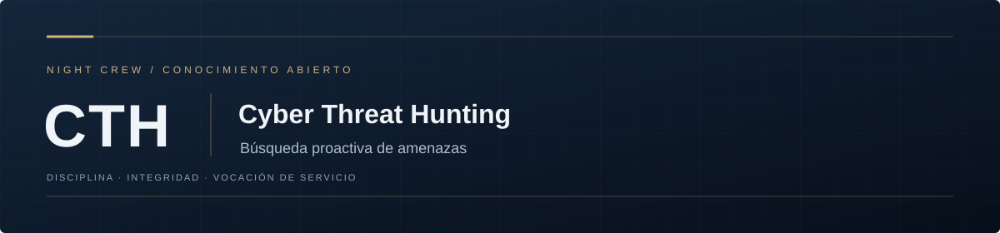

 
 

**Búsqueda proactiva de amenazas. Conocimiento al servicio de la seguridad digital.**

[Metodología](docs/METODOLOGIA.md) &nbsp; / &nbsp; [Plantilla](templates/REGISTRO.md) &nbsp; / &nbsp; [Contribuir](CONTRIBUTING.md)

 

## Misión

Desarrollar búsquedas defensivas que permitan contrastar hipótesis de actividad adversaria mediante telemetría autorizada, con resultados reproducibles y límites explícitos.

## Archivo documental

| Recurso | Finalidad |
| :--- | :--- |
| [Metodología](docs/METODOLOGIA.md) | Criterios de trabajo, validación y revisión. |
| [Plantilla de registro](templates/REGISTRO.md) | Estructura para documentar trabajo y evidencia. |
| [Guía de contribución](CONTRIBUTING.md) | Requisitos de calidad y publicación. |

**Estado:** base documental inicial. Los análisis, ejercicios y resultados se incorporarán cuando hayan sido elaborados y revisados.

## Principios

Disciplina en el método, integridad en la evidencia y vocación de servicio. Priorizamos la utilidad del conocimiento, el respeto por la privacidad y la colaboración responsable.

---

[CTI](https://github.com/NIGHTCREW-CL/CTI) &nbsp; / &nbsp; [CTH](https://github.com/NIGHTCREW-CL/CTH) &nbsp; / &nbsp; [CTF](https://github.com/NIGHTCREW-CL/CTF) &nbsp; / &nbsp; [EH](https://github.com/NIGHTCREW-CL/EH)

<strong>[NIGHT CREW](https://github.com/NIGHTCREW-CL)</strong> · Institución independiente, sin fines de lucro.

